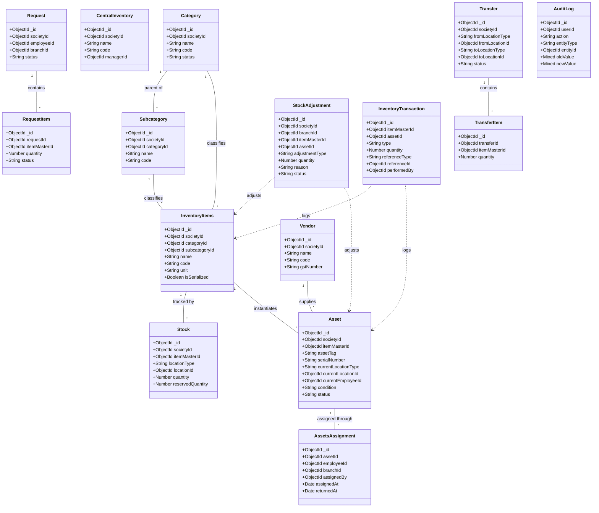

# Society Inventory Module - Database Schema Documentation

This document provides complete, definitive field specifications, data types, Mongoose model references, default values, schema validations, and database indexes for all **16 Mongoose models** powering the Society Inventory Module located in [`src/panels/society/inventory/models/`](file:///e:/office/New%20folder/sahayaone-backend/src/panels/society/inventory/models).

---

## Architecture Overview & Subsystem Grouping

The inventory database architecture is structured into 6 modular subsystems:



---

## Table of Contents

1. [Category Model (`Category` / `InventoryCategory`)](#1-category-model-category)
2. [Subcategory Model (`Subcategory`)](#2-subcategory-model-subcategory)
3. [Central Inventory Model (`CentralInventory`)](#3-central-inventory-model-centralinventory)
4. [Inventory Items Model (`InventoryItems`)](#4-inventory-items-model-inventoryitems)
5. [Vendor Model (`Vendor`)](#5-vendor-model-vendor)
6. [Stocks Model (`Stock`)](#6-stocks-model-stock)
7. [Asset Model (`Asset`)](#7-asset-model-asset)
8. [Request Model (`Request`)](#8-request-model-request)
9. [Request Item Model (`RequestItem`)](#9-request-item-model-requestitem)
10. [Transfer Model (`Transfer`)](#10-transfer-model-transfer)
11. [Transfer Item Model (`TransferItem`)](#11-transfer-item-model-transferitem)
12. [Assets Assignment Model (`AssetsAssignment`)](#12-assets-assignment-model-assetsassignment)
13. [Inventory Transaction Model (`InventoryTransaction`)](#13-inventory-transaction-model-inventorytransaction)
14. [Audit Logs Model (`AuditLog`)](#14-audit-logs-model-auditlog)
15. [Stock Adjustment Model (`StockAdjustment`)](#15-stock-adjustment-model-stockadjustment)
16. [Society Inventory Model (`SocietyInventory` - Legacy)](#16-society-inventory-model-societyinventory---legacy)
17. [Dynamic Reference (`refPath`) Mapping Guide](#17-dynamic-reference-refpath-mapping-guide)
18. [Database Indexes & Performance Matrix](#18-database-indexes--performance-matrix)

---

## 1. Category Model (`Category`)

- **Source File**: [`category.model.js`](file:///e:/office/New%20folder/sahayaone-backend/src/panels/society/inventory/models/category.model.js)
- **Exported Identifiers**: `Category`, `default`
- **Mongoose Model Name**: `InventoryCategory`
- **Description**: Stores top-level product classifications per society/bank (e.g. IT Equipment, Office Furniture, Stationery).

| Field | Type | Options / Validation | Reference | Description |
| :--- | :--- | :--- | :--- | :--- |
| `societyId` | `ObjectId` | Required, Indexed | `Bank` | Associated Bank/Society |
| `name` | `String` | Required, Trimmed | — | Human-readable Category Name |
| `code` | `String` | Required, Trimmed, Uppercase | — | Unique Category Code within the society (e.g., `IT`, `FURN`) |
| `description` | `String` | Trimmed, Default: `""` | — | Optional description |
| `status` | `String` | Enum: `['active', 'inactive']`, Default: `'active'` | — | Record Status |
| `createdAt` | `Date` | Auto-managed (`timestamps: true`) | — | Timestamp of creation |
| `updatedAt` | `Date` | Auto-managed (`timestamps: true`) | — | Timestamp of last modification |

### Indexes
```javascript
categorySchema.index({ societyId: 1, code: 1 }, { unique: true });
```

---

## 2. Subcategory Model (`Subcategory`)

- **Source File**: [`subcategory.model.js`](file:///e:/office/New%20folder/sahayaone-backend/src/panels/society/inventory/models/subcategory.model.js)
- **Exported Identifiers**: `Subcategory`, `default`
- **Mongoose Model Name**: `Subcategory`
- **Description**: Secondary categorization nested under a parent Category (e.g., Laptops, Printers under IT).

| Field | Type | Options / Validation | Reference | Description |
| :--- | :--- | :--- | :--- | :--- |
| `societyId` | `ObjectId` | Required, Indexed | `Bank` | Associated Bank/Society |
| `categoryId` | `ObjectId` | Required, Indexed | `InventoryCategory` | Parent Category ID |
| `name` | `String` | Required, Trimmed | — | Subcategory Name |
| `code` | `String` | Required, Trimmed, Uppercase | — | Unique Subcategory Code per parent Category |
| `description` | `String` | Trimmed, Default: `""` | — | Optional description |
| `status` | `String` | Enum: `['active', 'inactive']`, Default: `'active'` | — | Record Status |
| `createdAt` | `Date` | Auto-managed (`timestamps: true`) | — | Timestamp of creation |
| `updatedAt` | `Date` | Auto-managed (`timestamps: true`) | — | Timestamp of last modification |

### Indexes
```javascript
subcategorySchema.index({ categoryId: 1, code: 1 }, { unique: true });
```

---

## 3. Central Inventory Model (`CentralInventory`)

- **Source File**: [`centralInventory.model.js`](file:///e:/office/New%20folder/sahayaone-backend/src/panels/society/inventory/models/centralInventory.model.js)
- **Exported Identifiers**: `CentralInventory`, `default`
- **Mongoose Model Name**: `CentralInventory`
- **Description**: Society main warehouse facilities storing central bulk stock before branch distribution.

| Field | Type | Options / Validation | Reference | Description |
| :--- | :--- | :--- | :--- | :--- |
| `societyId` | `ObjectId` | Required, Indexed | `Bank` | Associated Bank/Society |
| `name` | `String` | Required, Trimmed | — | Central Warehouse Name (e.g., "Head Office Central Stores") |
| `code` | `String` | Required, Trimmed, Uppercase | — | Unique Warehouse Code per society (e.g., `WH-HQ-01`) |
| `address` | `String` | Trimmed, Default: `""` | — | Physical street address |
| `managerId` | `ObjectId` | Required, Indexed | `User` | User managing this facility |
| `status` | `String` | Enum: `['active', 'inactive']`, Default: `'active'` | — | Facility status |
| `createdAt` | `Date` | Auto-managed (`timestamps: true`) | — | Timestamp of creation |
| `updatedAt` | `Date` | Auto-managed (`timestamps: true`) | — | Timestamp of last modification |

### Indexes
```javascript
centralInventorySchema.index({ societyId: 1, code: 1 }, { unique: true });
```

---

## 4. Inventory Items Model (`InventoryItems`)

- **Source File**: [`inventoryItem.model.js`](file:///e:/office/New%20folder/sahayaone-backend/src/panels/society/inventory/models/inventoryItem.model.js)
- **Exported Identifiers**: `InventoryItems`, `default`
- **Mongoose Model Name**: `InventoryItems`
- **Description**: Master catalog SKU definitions. Distinguishes between consumable bulk items (`isSerialized: false`) and individual trackable fixed assets (`isSerialized: true`).

| Field | Type | Options / Validation | Reference | Description |
| :--- | :--- | :--- | :--- | :--- |
| `societyId` | `ObjectId` | Required, Indexed | `Bank` | Associated Bank/Society |
| `categoryId` | `ObjectId` | Required, Indexed | `InventoryCategory` | Primary Category reference |
| `subcategoryId` | `ObjectId` | Indexed, Optional | `Subcategory` | Secondary Subcategory reference |
| `name` | `String` | Required, Trimmed | — | Product / SKU Master Name |
| `code` | `String` | Required, Trimmed, Uppercase | — | Unique SKU code (e.g., `SKU-DELL-XPS15`) |
| `description` | `String` | Trimmed, Default: `""` | — | Product specifications |
| `type` | `String` | Trimmed, Optional | — | Classification subtype |
| `unit` | `String` | Required, Trimmed | — | Unit of measurement (e.g., `Pcs`, `Box`, `Ream`, `Kg`) |
| `brand` | `String` | Trimmed, Default: `""` | — | Brand / Manufacturer |
| `model` | `String` | Trimmed, Default: `""` | — | Model number |
| `isSerialized` | `Boolean` | Default: `false` | — | If `true`, requires barcode/serial tracking via `Asset` |
| `status` | `String` | Enum: `['active', 'inactive']`, Default: `'active'` | — | Catalog Item status |
| `createdAt` | `Date` | Auto-managed (`timestamps: true`) | — | Timestamp of creation |
| `updatedAt` | `Date` | Auto-managed (`timestamps: true`) | — | Timestamp of last modification |

### Indexes
```javascript
inventoryItemsSchema.index({ societyId: 1, code: 1 }, { unique: true });
```

---

## 5. Vendor Model (`Vendor`)

- **Source File**: [`vendor.model.js`](file:///e:/office/New%20folder/sahayaone-backend/src/panels/society/inventory/models/vendor.model.js)
- **Exported Identifiers**: `Vendor`, `default`
- **Mongoose Model Name**: `Vendor`
- **Description**: Directory of approved suppliers, equipment distributors, and maintenance vendors.

| Field | Type | Options / Validation | Reference | Description |
| :--- | :--- | :--- | :--- | :--- |
| `societyId` | `ObjectId` | Required, Indexed | `Bank` | Associated Bank/Society |
| `name` | `String` | Required, Trimmed | — | Vendor Business / Company Name |
| `code` | `String` | Required, Trimmed, Uppercase | — | Unique Vendor Code per society (e.g., `VEND-TECH-001`) |
| `contactPerson` | `String` | Trimmed, Default: `""` | — | Primary contact person name |
| `phone` | `String` | Trimmed, Default: `""` | — | Phone / Mobile Number |
| `email` | `String` | Trimmed, Lowercase, Default: `""` | — | Email address |
| `address` | `String` | Trimmed, Default: `""` | — | Office / Warehouse address |
| `gstNumber` | `String` | Trimmed, Uppercase, Default: `""` | — | GSTIN / Tax Identification |
| `status` | `String` | Enum: `['active', 'inactive']`, Default: `'active'` | — | Vendor status |
| `createdAt` | `Date` | Auto-managed (`timestamps: true`) | — | Timestamp of creation |
| `updatedAt` | `Date` | Auto-managed (`timestamps: true`) | — | Timestamp of last modification |

### Indexes
```javascript
vendorSchema.index({ societyId: 1, code: 1 }, { unique: true });
vendorSchema.index(
    { societyId: 1, gstNumber: 1 },
    { unique: true, partialFilterExpression: { gstNumber: { $exists: true, $ne: '' } } }
);
```

---

## 6. Stocks Model (`Stock`)

- **Source File**: [`stocks.model.js`](file:///e:/office/New%20folder/sahayaone-backend/src/panels/society/inventory/models/stocks.model.js)
- **Exported Identifiers**: `Stock`, `default`
- **Mongoose Model Name**: `Stock`
- **Description**: Real-time aggregated quantity ledger per SKU per location (Central Warehouse or Branch). Supports reserved quantity holds during pending transfers/orders.

| Field | Type | Options / Validation | Reference | Description |
| :--- | :--- | :--- | :--- | :--- |
| `societyId` | `ObjectId` | Required, Indexed | `Bank` | Associated Bank/Society |
| `itemMasterId` | `ObjectId` | Required, Indexed | `InventoryItems` | Master SKU reference |
| `locationType` | `String` | Required, Enum: `['CentralInventory', 'Branch']` | — | Polymorphic Location Type |
| `locationId` | `ObjectId` | Required | `refPath: 'locationType'` | Target Warehouse ID or Branch ID |
| `quantity` | `Number` | Required, Default: `0`, Min: `0` | — | Physical on-hand stock quantity |
| `reservedQuantity` | `Number` | Required, Default: `0`, Min: `0` | — | Units reserved for pending transfers or orders |
| `createdAt` | `Date` | Auto-managed (`timestamps: true`) | — | Timestamp of creation |
| `updatedAt` | `Date` | Auto-managed (`timestamps: true`) | — | Timestamp of last modification |

### Indexes
```javascript
stockSchema.index({ itemMasterId: 1, locationType: 1, locationId: 1 }, { unique: true });
```

---

## 7. Asset Model (`Asset`)

- **Source File**: [`Itemsasset.model.js`](file:///e:/office/New%20folder/sahayaone-backend/src/panels/society/inventory/models/Itemsasset.model.js)
- **Exported Identifiers**: `Asset`, `default`
- **Mongoose Model Name**: `Asset`
- **Description**: Tracks unique, serialized asset units individually throughout their lifecycle (acquisition, employee assignment, maintenance, disposal, recovery).

| Field | Type | Options / Validation | Reference | Description |
| :--- | :--- | :--- | :--- | :--- |
| `societyId` | `ObjectId` | Required, Indexed | `Bank` | Associated Bank/Society |
| `itemMasterId` | `ObjectId` | Required, Indexed | `InventoryItems` | Master SKU reference |
| `assetTag` | `String` | Required, Trimmed, Uppercase | — | Unique Barcode / Tag ID (e.g., `AST-MN-0042`) |
| `serialNumber` | `String` | Trimmed, Default: `""` | — | OEM hardware serial number |
| `currentLocationType` | `String` | Required, Enum: `['CentralInventory', 'Branch', 'User']` | — | Polymorphic Current Location Type |
| `currentLocationId` | `ObjectId` | Required | `refPath: 'currentLocationType'` | Current Location / Custodian ID |
| `currentEmployeeId` | `ObjectId` | Default: `null`, Optional | `User` | Currently assigned employee User ID |
| `condition` | `String` | Enum: `['new', 'good', 'fair', 'damaged', 'scrapped']`, Default: `'new'` | — | Physical state of unit |
| `status` | `String` | Enum: `['active', 'in_repair', 'retired', 'lost']`, Default: `'active'` | — | Operational availability |
| `purchaseDate` | `Date` | Optional | — | Date acquired |
| `purchasePrice` | `Number` | Min: `0`, Optional | — | Unit acquisition cost |
| `vendorId` | `ObjectId` | Indexed, Optional | `Vendor` | Supplier ID |
| `warrantyStartDate` | `Date` | Optional | — | Warranty coverage start |
| `warrantyEndDate` | `Date` | Optional | — | Warranty coverage expiration |
| `createdAt` | `Date` | Auto-managed (`timestamps: true`) | — | Timestamp of creation |
| `updatedAt` | `Date` | Auto-managed (`timestamps: true`) | — | Timestamp of last modification |

### Indexes
```javascript
assetSchema.index({ societyId: 1, assetTag: 1 }, { unique: true });
assetSchema.index(
    { societyId: 1, serialNumber: 1 },
    { unique: true, partialFilterExpression: { serialNumber: { $exists: true, $ne: '' } } }
);
```

---

## 8. Request Model (`Request`)

- **Source File**: [`request.model.js`](file:///e:/office/New%20folder/sahayaone-backend/src/panels/society/inventory/models/request.model.js)
- **Exported Identifiers**: `Request`, `default`
- **Mongoose Model Name**: `Request`
- **Description**: Header record for branch/employee item requisitions.

| Field | Type | Options / Validation | Reference | Description |
| :--- | :--- | :--- | :--- | :--- |
| `societyId` | `ObjectId` | Required, Indexed | `Bank` | Associated Bank/Society |
| `employeeId` | `ObjectId` | Required, Indexed | `User` | Requesting staff member |
| `branchId` | `ObjectId` | Required, Indexed | `Branch` | Requesting branch location |
| `status` | `String` | Enum: `['PENDING', 'APPROVED', 'REJECTED', 'FULFILLED', 'CANCELLED']`, Default: `'PENDING'`, Indexed | — | Workflow state |
| `remarks` | `String` | Trimmed, Default: `""` | — | Requester / Approver notes |
| `createdAt` | `Date` | Auto-managed (`timestamps: true`) | — | Timestamp of creation |
| `updatedAt` | `Date` | Auto-managed (`timestamps: true`) | — | Timestamp of last modification |

---

## 9. Request Item Model (`RequestItem`)

- **Source File**: [`requestedItem.model.js`](file:///e:/office/New%20folder/sahayaone-backend/src/panels/society/inventory/models/requestedItem.model.js)
- **Exported Identifiers**: `RequestItem`, `default`
- **Mongoose Model Name**: `RequestItem`
- **Description**: Line items associated with a requisition header (`Request`).

| Field | Type | Options / Validation | Reference | Description |
| :--- | :--- | :--- | :--- | :--- |
| `requestId` | `ObjectId` | Required, Indexed | `Request` | Parent Request Header ID |
| `itemMasterId` | `ObjectId` | Required, Indexed | `InventoryItems` | Requested SKU ID |
| `quantity` | `Number` | Required, Min: `0` | — | Quantity requested |
| `status` | `String` | Enum: `['PENDING', 'APPROVED', 'REJECTED', 'FULFILLED', 'CANCELLED']`, Default: `'PENDING'` | — | Individual line item status |
| `createdAt` | `Date` | Auto-managed (`timestamps: true`) | — | Timestamp of creation |
| `updatedAt` | `Date` | Auto-managed (`timestamps: true`) | — | Timestamp of last modification |

### Indexes
```javascript
requestItemSchema.index({ requestId: 1, itemMasterId: 1 }, { unique: true });
```

---

## 10. Transfer Model (`Transfer`)

- **Source File**: [`transfer.model.js`](file:///e:/office/New%20folder/sahayaone-backend/src/panels/society/inventory/models/transfer.model.js)
- **Exported Identifiers**: `Transfer`, `default`
- **Mongoose Model Name**: `Transfer`
- **Description**: Header record for physical stock movement between locations (Warehouse-to-Branch, Branch-to-Branch, or Branch-to-Warehouse).

| Field | Type | Options / Validation | Reference | Description |
| :--- | :--- | :--- | :--- | :--- |
| `societyId` | `ObjectId` | Required, Indexed | `Bank` | Associated Bank/Society |
| `fromLocationType` | `String` | Required, Enum: `['CentralInventory', 'Branch']` | — | Origin Location Type |
| `fromLocationId` | `ObjectId` | Required | `refPath: 'fromLocationType'` | Origin Warehouse / Branch ID |
| `toLocationType` | `String` | Required, Enum: `['CentralInventory', 'Branch']` | — | Destination Location Type |
| `toLocationId` | `ObjectId` | Required | `refPath: 'toLocationType'` | Destination Warehouse / Branch ID |
| `requestedBy` | `ObjectId` | Required, Indexed | `User` | User who initiated the transfer |
| `status` | `String` | Enum: `['PENDING', 'APPROVED', 'DISPATCHED', 'RECEIVED']`, Default: `'PENDING'`, Indexed | — | Transfer dispatch & receipt status |
| `remarks` | `String` | Trimmed, Default: `""` | — | Transfer transit remarks |
| `createdAt` | `Date` | Auto-managed (`timestamps: true`) | — | Timestamp of creation |
| `updatedAt` | `Date` | Auto-managed (`timestamps: true`) | — | Timestamp of last modification |

---

## 11. Transfer Item Model (`TransferItem`)

- **Source File**: [`transferItem.model.js`](file:///e:/office/New%20folder/sahayaone-backend/src/panels/society/inventory/models/transferItem.model.js)
- **Exported Identifiers**: `TransferItem`, `default`
- **Mongoose Model Name**: `TransferItem`
- **Description**: Line items associated with a stock transfer header (`Transfer`).

| Field | Type | Options / Validation | Reference | Description |
| :--- | :--- | :--- | :--- | :--- |
| `transferId` | `ObjectId` | Required, Indexed | `Transfer` | Parent Transfer Header ID |
| `itemMasterId` | `ObjectId` | Required, Indexed | `InventoryItems` | Transferred SKU ID |
| `quantity` | `Number` | Required, Min: `0` | — | Quantity transferred |
| `createdAt` | `Date` | Auto-managed (`timestamps: true`) | — | Timestamp of creation |
| `updatedAt` | `Date` | Auto-managed (`timestamps: true`) | — | Timestamp of last modification |

### Indexes
```javascript
transferItemSchema.index({ transferId: 1, itemMasterId: 1 }, { unique: true });
```

---

## 12. Assets Assignment Model (`AssetsAssignment`)

- **Source File**: [`assetsAssignment.model.js`](file:///e:/office/New%20folder/sahayaone-backend/src/panels/society/inventory/models/assetsAssignment.model.js)
- **Exported Identifiers**: `AssetsAssignment`, `default`
- **Mongoose Model Name**: `AssetsAssignment`
- **Description**: Complete historical issuance and custody log of individual serialized assets assigned to employees.

| Field | Type | Options / Validation | Reference | Description |
| :--- | :--- | :--- | :--- | :--- |
| `assetId` | `ObjectId` | Required | `Asset` | Serialized Asset ID |
| `employeeId` | `ObjectId` | Required | `User` | Custodian Employee ID |
| `branchId` | `ObjectId` | Required | `Branch` | Assigned Branch ID |
| `assignedBy` | `ObjectId` | Required | `User` | Manager/Officer who issued asset |
| `assignedAt` | `Date` | Required | — | Date and time asset was issued |
| `condition` | `String` | Optional | — | Physical condition during issuance |
| `remarks` | `String` | Trimmed, Default: `""` | — | Assignment notes |
| `returnedAt` | `Date` | Default: `null` | — | Date returned (null while active) |
| `createdAt` | `Date` | Auto-managed (`timestamps: true`) | — | Timestamp of creation |
| `updatedAt` | `Date` | Auto-managed (`timestamps: true`) | — | Timestamp of last modification |

---

## 13. Inventory Transaction Model (`InventoryTransaction`)

- **Source File**: [`inventoryTransaction.model.js`](file:///e:/office/New%20folder/sahayaone-backend/src/panels/society/inventory/models/inventoryTransaction.model.js)
- **Exported Identifiers**: `InventoryTransaction`, `default`
- **Mongoose Model Name**: `InventoryTransaction`
- **Description**: Immutable append-only transaction ledger recording every stock movement, issuance, return, transfer, and physical variance adjustment.

| Field | Type | Options / Validation | Reference | Description |
| :--- | :--- | :--- | :--- | :--- |
| `itemMasterId` | `ObjectId` | Optional | `InventoryItems` | Transacted SKU ID |
| `assetId` | `ObjectId` | Optional | `Asset` | Serialized Asset ID (if asset event) |
| `locationType` | `String` | Enum: `['CentralInventory', 'Branch', 'User']`, Optional | — | Polymorphic Location Type |
| `locationId` | `ObjectId` | Optional | `refPath: 'locationType'` | Location ID where transaction took place |
| `type` | `String` | Required, Enum: `['STOCK_IN', 'ISSUE', 'RETURN', 'TRANSFER', 'ADJUSTMENT']` | — | Transaction nature |
| `quantity` | `Number` | Optional | — | Units impacted |
| `referenceType` | `String` | Enum: `['Request', 'Transfer', 'StockAdjustment', 'Vendor', 'AssetsAssignment']`, Optional | — | Source document type |
| `referenceId` | `ObjectId` | Optional | `refPath: 'referenceType'` | Source document ID |
| `performedBy` | `ObjectId` | Required | `User` | User who logged/executed transaction |
| `remarks` | `String` | Trimmed, Default: `""` | — | Transaction narrative |
| `createdAt` | `Date` | Default: `Date.now` | — | Transaction timestamp |

---

## 14. Audit Logs Model (`AuditLog`)

- **Source File**: [`auditLogs.model.js`](file:///e:/office/New%20folder/sahayaone-backend/src/panels/society/inventory/models/auditLogs.model.js)
- **Exported Identifiers**: `AuditLog`, `default`
- **Mongoose Model Name**: `AuditLog`
- **Description**: System-wide compliance audit trail recording granular field-level state changes (`oldValue` vs `newValue`) across any inventory entity.

| Field | Type | Options / Validation | Reference | Description |
| :--- | :--- | :--- | :--- | :--- |
| `userId` | `ObjectId` | Required | `User` | Actor performing action |
| `action` | `String` | Required | — | Action verb (e.g., `CREATE`, `UPDATE`, `APPROVE`, `DELETE`) |
| `entityType` | `String` | Required | — | Target Mongoose Model Name |
| `entityId` | `ObjectId` | Required | `refPath: 'entityType'` | Target Record ID |
| `oldValue` | `Mixed` | Optional | — | Snapshot before mutation |
| `newValue` | `Mixed` | Optional | — | Snapshot after mutation |
| `remarks` | `String` | Trimmed, Default: `""` | — | Audit trail remarks |
| `createdAt` | `Date` | Default: `Date.now` | — | Timestamp of event |

---

## 15. Stock Adjustment Model (`StockAdjustment`)

- **Source File**: [`stockAdjustment.model.js`](file:///e:/office/New%20folder/sahayaone-backend/src/panels/society/inventory/models/stockAdjustment.model.js)
- **Exported Identifiers**: `StockAdjustment`, `default`
- **Mongoose Model Name**: `StockAdjustment`
- **Description**: Dual-control approval workflow for physical stock variances, damage write-offs, lost assets, recoveries, and audit corrections. Modifies stock quantities only upon manager approval.

| Field | Type | Options / Validation | Reference | Description |
| :--- | :--- | :--- | :--- | :--- |
| `societyId` | `ObjectId` | Required, Indexed | `Bank` | Associated Bank/Society |
| `branchId` | `ObjectId` | Required, Indexed | `Branch` | Branch location where variance occurred |
| `itemMasterId` | `ObjectId` | Required, Indexed | `InventoryItems` | Master SKU adjusted |
| `assetId` | `ObjectId` | Default: `null`, Optional | `Asset` | Serialized Asset ID (if serialized item) |
| `locationType` | `String` | Required, Enum: `['CentralInventory', 'Branch']` | — | Target location type |
| `locationId` | `ObjectId` | Required | `refPath: 'locationType'` | Target Warehouse ID or Branch ID |
| `adjustmentType` | `String` | Required, Enum: `['INCREASE', 'DECREASE']` | — | Direction of delta (+Qty or -Qty) |
| `quantity` | `Number` | Required, Min: `1` | — | Units to adjust |
| `reason` | `String` | Required, Enum: `['DAMAGE', 'LOST', 'AUDIT_DISCREPANCY', 'RECOVERY', 'EXPIRED']` | — | Reason for adjustment |
| `status` | `String` | Enum: `['PENDING', 'APPROVED', 'REJECTED']`, Default: `'PENDING'`, Indexed | — | Approval status |
| `requestedBy` | `ObjectId` | Required | `User` | User requesting adjustment |
| `approvedBy` | `ObjectId` | Default: `null`, Optional | `User` | Manager/Admin who approved or rejected |
| `remarks` | `String` | Trimmed, Default: `""` | — | Justification / investigation notes |
| `createdAt` | `Date` | Auto-managed (`timestamps: true`) | — | Timestamp of creation |
| `updatedAt` | `Date` | Auto-managed (`timestamps: true`) | — | Timestamp of last modification |

---

## 16. Society Inventory Model (`SocietyInventory` - Legacy)

- **Source File**: [`society-inventory.model.js`](file:///e:/office/New%20folder/sahayaone-backend/src/panels/society/inventory/models/society-inventory.model.js)
- **Exported Identifiers**: `SocietyInventory`, `default`
- **Mongoose Model Name**: `SocietyInventory`
- **Description**: Legacy flat inventory table providing backward compatibility for earlier non-relational inventory features. Uses soft-deletion.

| Field | Type | Options / Validation | Reference | Description |
| :--- | :--- | :--- | :--- | :--- |
| `bankId` | `ObjectId` | Required, Indexed | `Bank` | Associated Bank/Society |
| `branchId` | `ObjectId` | Default: `null`, Indexed | `Branch` | Associated Branch (or null for society-wide) |
| `assets` | `String` | Required, Trimmed | — | Free-text Asset Description |
| `quantity` | `Number` | Required, Min: `0` | — | Quantity count |
| `createdBy` | `ObjectId` | Required | `User` | Creator User ID |
| `updatedBy` | `ObjectId` | Default: `null` | `User` | Updater User ID |
| `isDeleted` | `Boolean` | Soft-delete plugin, Default: `false` | — | Soft deletion flag |
| `deletedAt` | `Date` | Soft-delete plugin, Default: `null` | — | Timestamp of soft deletion |
| `deletedBy` | `ObjectId` | Soft-delete plugin, Default: `null` | `User` | User who soft-deleted record |
| `createdAt` | `Date` | Auto-managed (`timestamps: true`) | — | Timestamp of creation |
| `updatedAt` | `Date` | Auto-managed (`timestamps: true`) | — | Timestamp of last modification |

### Schema Options
```javascript
{
    timestamps: true,
    versionKey: false
}
```

### Indexes
```javascript
societyInventorySchema.index(
    { bankId: 1, branchId: 1, assets: 1 },
    { unique: true, partialFilterExpression: { isDeleted: false } }
);
societyInventorySchema.index({ bankId: 1, branchId: 1, createdAt: -1 });
```

---

## 17. Dynamic Reference (`refPath`) Mapping Guide

Several models employ Mongoose dynamic polymorphism (`refPath`) to store references to diverse entity types dynamically. Below is the mapping matrix:

| Model | Dynamic Field | Controlling Type Field | Allowed Enum Types | Target Mongoose Model Resolved |
| :--- | :--- | :--- | :--- | :--- |
| **`Stock`** | `locationId` | `locationType` | `'CentralInventory'`<br>`'Branch'` | `CentralInventory`<br>`Branch` |
| **`Asset`** | `currentLocationId` | `currentLocationType` | `'CentralInventory'`<br>`'Branch'`<br>`'User'` | `CentralInventory`<br>`Branch`<br>`User` |
| **`Transfer`** | `fromLocationId` | `fromLocationType` | `'CentralInventory'`<br>`'Branch'` | `CentralInventory`<br>`Branch` |
| **`Transfer`** | `toLocationId` | `toLocationType` | `'CentralInventory'`<br>`'Branch'` | `CentralInventory`<br>`Branch` |
| **`StockAdjustment`** | `locationId` | `locationType` | `'CentralInventory'`<br>`'Branch'` | `CentralInventory`<br>`Branch` |
| **`InventoryTransaction`** | `locationId` | `locationType` | `'CentralInventory'`<br>`'Branch'`<br>`'User'` | `CentralInventory`<br>`Branch`<br>`User` |
| **`InventoryTransaction`** | `referenceId` | `referenceType` | `'Request'`<br>`'Transfer'`<br>`'StockAdjustment'`<br>`'Vendor'`<br>`'AssetsAssignment'` | `Request`<br>`Transfer`<br>`StockAdjustment`<br>`Vendor`<br>`AssetsAssignment` |
| **`AuditLog`** | `entityId` | `entityType` | Any Model Name string | Dynamically resolved model |

---

## 18. Database Indexes & Performance Matrix

| Model | Index Key Definition | Index Options | Purpose / Invariant |
| :--- | :--- | :--- | :--- |
| **`Category`** | `{ societyId: 1, code: 1 }` | `unique: true` | Prevents duplicate category codes within the same society |
| **`Subcategory`** | `{ categoryId: 1, code: 1 }` | `unique: true` | Prevents duplicate subcategory codes under the same category |
| **`CentralInventory`** | `{ societyId: 1, code: 1 }` | `unique: true` | Enforces unique warehouse codes per society |
| **`InventoryItems`** | `{ societyId: 1, code: 1 }` | `unique: true` | Enforces unique SKU codes per society |
| **`Vendor`** | `{ societyId: 1, code: 1 }` | `unique: true` | Prevents duplicate vendor codes per society |
| **`Vendor`** | `{ societyId: 1, gstNumber: 1 }` | `unique: true, partialFilterExpression: { gstNumber: { $exists: true, $ne: '' } }` | Enforces unique GST numbers per society when provided |
| **`Stock`** | `{ itemMasterId: 1, locationType: 1, locationId: 1 }` | `unique: true` | Ensures exactly one aggregate stock record per SKU per warehouse or branch |
| **`Asset`** | `{ societyId: 1, assetTag: 1 }` | `unique: true` | Prevents barcode / asset tag duplication across society |
| **`Asset`** | `{ societyId: 1, serialNumber: 1 }` | `unique: true, partialFilterExpression: { serialNumber: { $exists: true, $ne: '' } }` | Enforces unique serial numbers per society when entered |
| **`RequestItem`** | `{ requestId: 1, itemMasterId: 1 }` | `unique: true` | Prevents duplicate SKU line items on the same requisition |
| **`TransferItem`** | `{ transferId: 1, itemMasterId: 1 }` | `unique: true` | Prevents duplicate SKU line items on the same transfer |
| **`SocietyInventory`** | `{ bankId: 1, branchId: 1, assets: 1 }` | `unique: true, partialFilterExpression: { isDeleted: false }` | Legacy uniqueness on active records |
| **`SocietyInventory`** | `{ bankId: 1, branchId: 1, createdAt: -1 }` | standard | Optimized sorting on legacy history |
