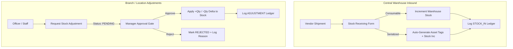

# Central Stock Receiving & Stock Adjustment Modules - Frontend Implementation Plan

This document outlines the complete frontend architecture, component design, state management, form validation, RBAC guards, and API client layer for integrating both **Central Stock Receiving (`Stock-In`)** and **Stock Adjustments** into the **Sahayaone Co-Operative Society Portal**.

---

## Table of Contents
1. [Executive Summary & Architecture Overview](#1-executive-summary--architecture-overview)
2. [Role-Based Access Control (RBAC) Matrix](#2-role-based-access-control-rbac-matrix)
3. [Component Hierarchy & Routing Structure](#3-component-hierarchy--routing-structure)
4. [Data Models & TypeScript Interfaces](#4-data-models--typescript-interfaces)
5. [API Service Layer Implementation](#5-api-service-layer-implementation)
6. [UI/UX Screen Blueprints & Wireframes](#6-uiux-screen-blueprints--wireframes)
   - 6.1 [Central Stock Receiving Drawer / Inbound Wizard](#61-central-stock-receiving-drawer--inbound-wizard)
   - 6.2 [Stock Adjustments Master Data Table](#62-stock-adjustments-master-data-table)
   - 6.3 [Create Stock Adjustment Drawer](#63-create-stock-adjustment-drawer)
   - 6.4 [Approval & Rejection Confirmation Dialogs](#64-approval--rejection-confirmation-dialogs)
7. [Form Validation Rules (Zod / React Hook Form)](#7-form-validation-rules-zod--react-hook-form)
8. [Edge Cases & Error Handling Guardrails](#8-edge-cases--error-handling-guardrails)
9. [Step-by-Step Implementation Roadmap](#9-step-by-step-implementation-roadmap)

---

## 1. Executive Summary & Architecture Overview

These two modules govern physical stock movements into and across society locations:

1. **Central Stock Receiving (`Stock-In`)**:
   - Handles inbound vendor shipments arriving at central society warehouses.
   - Automatically splits logic based on SKU type:
     - **Consumable SKUs** (`isSerialized: false`): Increments warehouse stock balance directly.
     - **Serialized SKUs** (`isSerialized: true`): Validates exact barcode asset tag counts, creates individual physical `Asset` units in the registry, and logs stock arrival.
   - Generates an immutable transaction ledger record (`type: 'STOCK_IN'`).

2. **Stock Adjustments**:
   - Implements a **dual-control audit reconciliation workflow** (`PENDING` ➔ `APPROVED` / `REJECTED`).
   - Accommodates physical stock count variances: damage write-offs, lost units, audit corrections, expiration, and scrap recovery.
   - Requires managerial approval before modifying active stock balances.



---

## 2. Role-Based Access Control (RBAC) Matrix

| Feature / UI Control | Capability Key | `BANK_OWNER` / `SOCIETY_ADMIN` | `INVENTORY_MANAGER` | `BRANCH_MANAGER` | `BRANCH_INVENTORY_OFFICER` | General Staff |
| :--- | :--- | :---: | :---: | :---: | :---: | :---: |
| **"Receive Stock" Button** | `central_stock.receive` | ✅ Allowed | ✅ Allowed | ❌ Hidden | ❌ Hidden | ❌ Hidden |
| **View Central Warehouses** | `central_stock.view` | ✅ Allowed | ✅ Allowed | ❌ Hidden | ❌ Hidden | ❌ Hidden |
| **View Stock Adjustments** | `stock_adjustment.view` | ✅ Full Society | ✅ Full Society | ✅ Branch Scoped | ✅ Branch Scoped | ❌ Hidden |
| **"Request Adjustment" Button** | `stock_adjustment.create` | ✅ (Select Branch) | ✅ (Select Branch) | ✅ (Auto Branch) | ✅ (Auto Branch) | ❌ Hidden |
| **"Approve" Adjustment Action**| `stock_adjustment.approve` | ✅ Active (`PENDING`) | ✅ Active (`PENDING`) | ✅ Active (`PENDING`) | ❌ Hidden | ❌ Hidden |
| **"Reject" Adjustment Action** | `stock_adjustment.approve` | ✅ Active (`PENDING`) | ✅ Active (`PENDING`) | ✅ Active (`PENDING`) | ❌ Hidden | ❌ Hidden |
| **"Edit" Pending Adjustment** | `stock_adjustment.update` | ✅ (Own/Branch) | ✅ (Own/Branch) | ✅ (Own/Branch) | ✅ (Own/Branch) | ❌ Hidden |
| **"Delete" Pending Adjustment**| `stock_adjustment.delete` | ✅ (Own/Branch) | ✅ (Own/Branch) | ✅ (Own/Branch) | ✅ (Own/Branch) | ❌ Hidden |

---

## 3. Component Hierarchy & Routing Structure

### Routing
```text
/inventory/
├── central/
│   ├── index.tsx                         # Central Warehouses & Stock-In History
│   └── receive.tsx                       # Dedicated Stock-In Receive Form / Modal
└── stock-adjustments/
    └── index.tsx                         # Stock Adjustments Master Page
```

### Component Architecture
```text
src/pages/inventory/
├── central/
│   ├── components/
│   │   ├── ReceiveStockDrawer.tsx        # Inbound Stock-In Wizard Drawer
│   │   ├── AssetTagsInputGrid.tsx        # Dynamic barcode / serial number tag builder
│   │   ├── InboundReceiptReceiptCard.tsx # Post-submit summary card with transaction ID
│   │   └── CentralStockTable.tsx         # Central stock levels & inbound logs
│   └── hooks/
│       └── useCentralStock.ts            # Hooks for warehouse list & receiveStock mutation
└── stock-adjustments/
    ├── components/
    │   ├── StockAdjustmentTable.tsx      # Paginated adjustments list with status badges
    │   ├── StockAdjustmentFilters.tsx    # Filter bar: Status tabs, Branch, Reason, Type
    │   ├── CreateAdjustmentModal.tsx     # New Adjustment Request Modal
    │   ├── EditAdjustmentModal.tsx       # Edit Pending Adjustment Modal
    │   ├── AdjustmentDetailDrawer.tsx    # Slide-over audit detail view
    │   ├── ApproveAdjustmentDialog.tsx   # Manager approval confirmation dialog
    │   └── RejectAdjustmentDialog.tsx    # Manager rejection dialog with reason prompt
    └── hooks/
        └── useStockAdjustments.ts        # Hooks for queries and adjustment mutations
```

---

## 4. Data Models & TypeScript Interfaces

Create file: `src/types/inventory.types.ts`

```typescript
// ==========================================
// 1. COMMON & CATALOG TYPES
// ==========================================
export interface PopulatedEntity {
  _id: string;
  name: string;
  code?: string;
}

export interface PopulatedItemMaster extends PopulatedEntity {
  unit: string;
  isSerialized: boolean;
}

export interface PopulatedUser {
  _id: string;
  fullName: string;
  email: string;
  phoneNumber?: string;
}

export interface PopulatedAsset {
  _id: string;
  assetTag: string;
  serialNumber?: string;
  status: string;
  condition: string;
}

export interface PaginationMeta {
  totalRecords: number;
  limit: number;
  page: number;
  totalPages: number;
  hasNextPage: boolean;
  hasPrevPage: boolean;
}

export interface ApiResponse<T> {
  success: boolean;
  statusCode: number;
  message: string;
  data: T;
  meta?: PaginationMeta;
}

// ==========================================
// 2. STOCK RECEIVING (STOCK-IN) TYPES
// ==========================================
export interface ReceiveStockPayload {
  centralInventoryId: string;
  itemMasterId: string;
  quantity: number;
  vendorId?: string | null;
  assetTags?: string[];      // Required if item.isSerialized === true (length === quantity)
  serialNumbers?: string[];  // Optional matching serial numbers
  remarks?: string;
}

export interface ReceiveStockResult {
  warehouse: PopulatedEntity;
  item: PopulatedItemMaster;
  quantityReceived: number;
  totalCentralStock: number;
  createdAssetsCount: number;
  transactionId: string;
}

export interface CentralWarehouse {
  _id: string;
  societyId: string;
  name: string;
  code: string;
  address?: string;
  managerId: PopulatedUser;
  status: 'active' | 'inactive';
}

// ==========================================
// 3. STOCK ADJUSTMENT TYPES
// ==========================================
export type AdjustmentType = 'INCREASE' | 'DECREASE';

export type AdjustmentReason = 
  | 'DAMAGE' 
  | 'LOST' 
  | 'AUDIT_DISCREPANCY' 
  | 'RECOVERY' 
  | 'EXPIRED';

export type AdjustmentStatus = 'PENDING' | 'APPROVED' | 'REJECTED';
export type LocationType = 'Branch' | 'CentralInventory';

export interface StockAdjustment {
  _id: string;
  societyId: string;
  branchId: PopulatedEntity;
  itemMasterId: PopulatedItemMaster;
  assetId: PopulatedAsset | null;
  locationType: LocationType;
  locationId: string;
  adjustmentType: AdjustmentType;
  quantity: number;
  reason: AdjustmentReason;
  status: AdjustmentStatus;
  requestedBy: PopulatedUser;
  approvedBy: PopulatedUser | null;
  remarks: string;
  createdAt: string;
  updatedAt: string;
}

export interface StockAdjustmentQueryParams {
  page?: number;
  limit?: number;
  branchId?: string;
  status?: AdjustmentStatus;
  reason?: AdjustmentReason;
  adjustmentType?: AdjustmentType;
  sortBy?: 'createdAt' | 'status' | 'quantity';
  sortOrder?: 'asc' | 'desc';
}

export interface CreateStockAdjustmentPayload {
  branchId: string; // Required for Admin/Owner, auto-filled for Branch Staff
  itemMasterId: string;
  locationType?: LocationType;
  locationId?: string;
  adjustmentType: AdjustmentType;
  quantity: number;
  reason: AdjustmentReason;
  assetId?: string | null;
  remarks?: string;
}

export interface UpdateStockAdjustmentPayload {
  quantity?: number;
  adjustmentType?: AdjustmentType;
  reason?: AdjustmentReason;
  assetId?: string | null;
  remarks?: string;
}

export interface ApproveRejectPayload {
  remarks?: string;
}
```

---

## 5. API Service Layer Implementation

Create file: `src/services/inventory.service.ts`

```typescript
import api from '@/lib/api-client'; // Axios instance configured with Bearer Token interceptor
import {
  ApiResponse,
  ReceiveStockPayload,
  ReceiveStockResult,
  CentralWarehouse,
  StockAdjustment,
  StockAdjustmentQueryParams,
  CreateStockAdjustmentPayload,
  UpdateStockAdjustmentPayload,
  ApproveRejectPayload,
  PopulatedItemMaster
} from '@/types/inventory.types';

export const inventoryService = {
  // ==========================================
  // CENTRAL STOCK RECEIVING
  // ==========================================
  
  // Fetch Central Warehouses for dropdown
  getCentralWarehouses: async (): Promise<ApiResponse<CentralWarehouse[]>> => {
    const response = await api.get<ApiResponse<CentralWarehouse[]>>('/api/v1/society/inventory/central');
    return response.data;
  },

  // Fetch Master SKUs for dropdown
  getItems: async (params?: { search?: string; limit?: number }): Promise<ApiResponse<PopulatedItemMaster[]>> => {
    const response = await api.get<ApiResponse<PopulatedItemMaster[]>>('/api/v1/society/inventory/items', { params });
    return response.data;
  },

  // Stock Receiving (Stock-In) into Central Inventory
  receiveStock: async (payload: ReceiveStockPayload): Promise<ApiResponse<ReceiveStockResult>> => {
    // Supports both primary endpoint and canonical alias
    const response = await api.post<ApiResponse<ReceiveStockResult>>(
      '/api/v1/society/inventory/central/stock-in',
      payload
    );
    return response.data;
  },

  // ==========================================
  // STOCK ADJUSTMENTS
  // ==========================================
  
  // List adjustments with filters and pagination
  listStockAdjustments: async (params?: StockAdjustmentQueryParams): Promise<ApiResponse<StockAdjustment[]>> => {
    const response = await api.get<ApiResponse<StockAdjustment[]>>(
      '/api/v1/society/inventory/stock-adjustments',
      { params }
    );
    return response.data;
  },

  // Get single adjustment detail by ID
  getStockAdjustmentById: async (id: string): Promise<ApiResponse<StockAdjustment>> => {
    const response = await api.get<ApiResponse<StockAdjustment>>(
      `/api/v1/society/inventory/stock-adjustments/${id}`
    );
    return response.data;
  },

  // Create new stock adjustment
  createStockAdjustment: async (payload: CreateStockAdjustmentPayload): Promise<ApiResponse<StockAdjustment>> => {
    const response = await api.post<ApiResponse<StockAdjustment>>(
      '/api/v1/society/inventory/stock-adjustments',
      payload
    );
    return response.data;
  },

  // Edit pending stock adjustment
  updateStockAdjustment: async (id: string, payload: UpdateStockAdjustmentPayload): Promise<ApiResponse<StockAdjustment>> => {
    const response = await api.put<ApiResponse<StockAdjustment>>(
      `/api/v1/society/inventory/stock-adjustments/${id}`,
      payload
    );
    return response.data;
  },

  // Cancel / Delete pending adjustment
  deleteStockAdjustment: async (id: string): Promise<ApiResponse<{ id: string; deleted: boolean }>> => {
    const response = await api.delete<ApiResponse<{ id: string; deleted: boolean }>>(
      `/api/v1/society/inventory/stock-adjustments/${id}`
    );
    return response.data;
  },

  // Approve stock adjustment (Manager Authority)
  approveStockAdjustment: async (id: string, payload?: ApproveRejectPayload): Promise<ApiResponse<StockAdjustment>> => {
    const response = await api.post<ApiResponse<StockAdjustment>>(
      `/api/v1/society/inventory/stock-adjustments/${id}/approve`,
      payload || {}
    );
    return response.data;
  },

  // Reject stock adjustment (Manager Authority)
  rejectStockAdjustment: async (id: string, payload?: ApproveRejectPayload): Promise<ApiResponse<StockAdjustment>> => {
    const response = await api.post<ApiResponse<StockAdjustment>>(
      `/api/v1/society/inventory/stock-adjustments/${id}/reject`,
      payload || {}
    );
    return response.data;
  }
};
```

---

## 6. UI/UX Screen Blueprints & Wireframes

### 6.1 Central Stock Receiving Drawer / Inbound Wizard

Accessible from: **Inventory > Central Stock > [ + Receive Inbound Stock ]**

```text
+-----------------------------------------------------------------------------------+
|  RECEIVE STOCK INTO CENTRAL WAREHOUSE                                        [ X ]|
+-----------------------------------------------------------------------------------+
|  1. Central Warehouse *                                                           |
|  [ Main Central Warehouse (WH-MAIN-01)                                          v ]|
|                                                                                   |
|  2. Item SKU Master *                                                             |
|  [ Search SKU (e.g., Dell XPS 15 9530 / SKU-DELL-XPS15)...                      v ]|
|  >> Badge: [ SERIALIZED ITEM - Asset tags required for every unit ]               |
|                                                                                   |
|  3. Supplier / Vendor (Optional)                                                  |
|  [ TechSupplies Pvt Ltd                                                         v ]|
|                                                                                   |
|  4. Quantity to Inbound *                                                         |
|  [ - ]  [   2   ]  [ + ]                                                          |
|                                                                                   |
|  5. Serialized Asset Identification (2 units required)                            |
|  +-------------------------------------------------------------------------------+|
|  | Unit # | Asset Barcode Tag *               | Serial Number (Optional)         ||
|  |--------|-----------------------------------|----------------------------------||
|  |   1    | [ TAG-LAP-001                   ] | [ SN-DELL-998811               ] ||
|  |   2    | [ TAG-LAP-002                   ] | [ SN-DELL-998812               ] ||
|  +-------------------------------------------------------------------------------+|
|  Tip: Scan barcode tags directly using a USB/Bluetooth barcode scanner.            |
|                                                                                   |
|  6. Shipment Remarks                                                              |
|  [ Invoice #INV-2026-904 batch received in good condition                        ]|
|                                                                                   |
|  [ Cancel ]                                            [ Receive Stock & Inbound ]|
+-----------------------------------------------------------------------------------+
```

#### Smart UX Features:
1. **Dynamic Asset Tag Grid**: If the selected SKU has `isSerialized: false` (e.g. A4 Paper reams), the Asset Tag table hides automatically. If `isSerialized: true`, the table renders rows dynamically matching the `quantity` counter.
2. **Barcode Scanner Friendly**: Form inputs auto-advance to the next tag field on carriage return (`Enter` key).
3. **Success Modal**: Upon successful response, a modal displays:
   - Units received: `2`
   - Total new central stock: `42`
   - Created Asset IDs: `TAG-LAP-001`, `TAG-LAP-002`
   - Ledger Transaction ID: `66d62c10...`

---

### 6.2 Stock Adjustments Master Data Table

Accessible from: **Inventory > Stock Adjustments**

```text
+----------------------------------------------------------------------------------------------------+
|  INVENTORY > STOCK ADJUSTMENTS                                            [ + Request Adjustment ] |
+----------------------------------------------------------------------------------------------------+
|  [ All Adjustments (18) ]  [ Pending Approval (3) ]  [ Approved (13) ]  [ Rejected (2) ]           |
+----------------------------------------------------------------------------------------------------+
|  [Q Search item/tag...]  Branch: [ All Branches v ]  Reason: [ All Reasons v ]  Type: [ All v ]   |
+----------------------------------------------------------------------------------------------------+
| Date       | Item Name       | Branch       | Type       | Qty | Reason       | Status    | Actions |
+----------------------------------------------------------------------------------------------------+
| 29/09/2026 | Samsung F23     | Manish Nagar | + INCREASE | 68  | DAMAGE       | [PENDING] | [...]   |
| 28/09/2026 | Dell XPS 15     | Pune Main    | - DECREASE | 2   | LOST         | [APPROVED]| [...]   |
| 27/09/2026 | A4 Paper Reams  | Pune Main    | - DECREASE | 15  | EXPIRED      | [REJECTED]| [...]   |
+----------------------------------------------------------------------------------------------------+
| Showing 1-10 of 18 records                                                   [ < Prev ] 1 [ 2 ] [ Next > ]|
+----------------------------------------------------------------------------------------------------+
```

#### Status Badge Palette:
- **`PENDING`**: Amber Badge (`bg-amber-50 text-amber-700 border-amber-300`)
- **`APPROVED`**: Emerald Badge (`bg-emerald-50 text-emerald-700 border-emerald-300`)
- **`REJECTED`**: Rose Badge (`bg-rose-50 text-rose-700 border-rose-300`)

#### Type Badges:
- **`INCREASE`**: `+ INCREASE` in Green text with upward arrow icon `↑`
- **`DECREASE`**: `- DECREASE` in Orange/Red text with downward arrow icon `↓`

---

### 6.3 Create Stock Adjustment Drawer

```text
+-------------------------------------------------------------------+
|  Request Stock Adjustment                                    [ X ] |
+-------------------------------------------------------------------+
|  Branch Location *                                                |
|  [ Manish Nagar Branch (MN2584)                                 v ]|
|  *(Auto-locked to current branch for Branch Officers & Managers)* |
|                                                                   |
|  Target Item SKU Master *                                         |
|  [ Samsung F23 (SKU-SAM-F23)                                    v ]|
|                                                                   |
|  Adjustment Type *                                                |
|  [ ( ) + INCREASE (Restock/Recovery)  (*) - DECREASE (Write-off) ]|
|                                                                   |
|  Adjustment Quantity *                                            |
|  [ - ]  [  68  ]  [ + ]                                           |
|                                                                   |
|  Adjustment Reason *                                              |
|  [ DAMAGE                                                       v ]|
|  Options: DAMAGE | LOST | AUDIT_DISCREPANCY | RECOVERY | EXPIRED   |
|                                                                   |
|  Linked Asset Unit (Optional)                                     |
|  [ Select specific serialized asset...                          v ]|
|                                                                   |
|  Remarks & Justification *                                        |
|  [ Packaging water-damaged during roof repair in storeroom       ]|
|                                                                   |
|  [ Cancel ]                                  [ Submit for Approval ]|
+-------------------------------------------------------------------+
```

---

### 6.4 Approval & Rejection Confirmation Dialogs

#### Approve Modal (`ApproveAdjustmentDialog.tsx`)
```text
+-------------------------------------------------------------------+
|  Approve Stock Adjustment                                    [ X ] |
+-------------------------------------------------------------------+
|  Are you sure you want to approve this adjustment?                |
|                                                                   |
|  Stock Impact:                                                    |
|  Item: Samsung F23                                                |
|  Location: Manish Nagar Branch                                    |
|  Adjustment: + 68 units (INCREASE)                                |
|                                                                   |
|  Approval Remarks (Optional):                                     |
|  [ Physical count confirmed with branch officer                 ] |
|                                                                   |
|  [ Cancel ]                               [ Confirm & Apply Stock ]|
+-------------------------------------------------------------------+
```

#### Reject Modal (`RejectAdjustmentDialog.tsx`)
```text
+-------------------------------------------------------------------+
|  Reject Stock Adjustment                                     [ X ] |
+-------------------------------------------------------------------+
|  Stock balance will not be modified. Please provide a mandatory    |
|  rejection reason for the audit trail:                            |
|                                                                   |
|  Rejection Reason *                                               |
|  [ Verification shows items are undamaged in storage bin 3      ] |
|                                                                   |
|  [ Cancel ]                                    [ Confirm Rejection ]|
+-------------------------------------------------------------------+
```

---

## 7. Form Validation Rules (Zod / React Hook Form)

Create file: `src/schemas/inventory.schema.ts`

```typescript
import { z } from 'zod';

// ==========================================
// 1. RECEIVE STOCK SCHEMA
// ==========================================
export const receiveStockSchema = z.object({
  centralInventoryId: z
    .string({ required_error: 'Central Warehouse selection is required' })
    .length(24, 'Invalid Central Warehouse ID'),
  itemMasterId: z
    .string({ required_error: 'Item SKU selection is required' })
    .length(24, 'Invalid Item SKU ID'),
  quantity: z
    .number({ required_error: 'Quantity is required' })
    .int('Quantity must be a whole number')
    .min(1, 'Quantity must be at least 1 unit'),
  vendorId: z
    .string()
    .length(24, 'Invalid Vendor ID')
    .nullable()
    .optional(),
  assetTags: z
    .array(z.string().trim().min(1, 'Asset tag cannot be empty'))
    .optional(),
  serialNumbers: z
    .array(z.string().trim())
    .optional(),
  remarks: z
    .string()
    .max(500, 'Remarks cannot exceed 500 characters')
    .optional()
    .default('')
}).superRefine((data, ctx) => {
  // If assetTags are provided, their length must match quantity
  if (data.assetTags && data.assetTags.length > 0) {
    if (data.assetTags.length !== data.quantity) {
      ctx.addIssue({
        code: z.ZodIssueCode.custom,
        message: `Exactly ${data.quantity} asset tags are required (currently ${data.assetTags.length})`,
        path: ['assetTags']
      });
    }

    // Check for duplicate tags within the same submission
    const tagSet = new Set(data.assetTags.map(t => t.toUpperCase()));
    if (tagSet.size !== data.assetTags.length) {
      ctx.addIssue({
        code: z.ZodIssueCode.custom,
        message: 'Duplicate asset tags detected in submission list',
        path: ['assetTags']
      });
    }
  }
});

export type ReceiveStockFormValues = z.infer<typeof receiveStockSchema>;

// ==========================================
// 2. STOCK ADJUSTMENT SCHEMA
// ==========================================
export const createStockAdjustmentSchema = z.object({
  branchId: z
    .string({ required_error: 'Branch selection is required' })
    .length(24, 'Invalid Branch ID format'),
  itemMasterId: z
    .string({ required_error: 'Please select an item SKU' })
    .length(24, 'Invalid Item SKU ID'),
  adjustmentType: z.enum(['INCREASE', 'DECREASE'], {
    required_error: 'Specify whether adjustment is an Increase or Decrease'
  }),
  quantity: z
    .number({ required_error: 'Quantity is required' })
    .int('Quantity must be an integer')
    .min(1, 'Quantity must be at least 1'),
  reason: z.enum(['DAMAGE', 'LOST', 'AUDIT_DISCREPANCY', 'RECOVERY', 'EXPIRED'], {
    required_error: 'Please select an adjustment reason'
  }),
  locationType: z.enum(['Branch', 'CentralInventory']).default('Branch'),
  locationId: z.string().optional(),
  assetId: z.string().nullable().optional(),
  remarks: z
    .string()
    .max(500, 'Remarks cannot exceed 500 characters')
    .optional()
    .default('')
});

export type CreateStockAdjustmentFormValues = z.infer<typeof createStockAdjustmentSchema>;
```

---

## 8. Edge Cases & Error Handling Guardrails

### 1. Bank Owner & Society Admin Branch Context Guard
- **The Issue**: Bank Owner / Society Admin tokens have `branchId: null`. If `branchId` is omitted, the API throws `400 Bad Request: A valid Branch ID is required`.
- **Frontend Guard**:
  ```typescript
  const user = useAuthUser();
  const isGlobalAdmin = ['BANK_OWNER', 'SOCIETY_ADMIN'].includes(user.role);

  // If user is global admin, enforce manual branch selection from dropdown:
  const defaultBranchId = isGlobalAdmin ? '' : user.branchId;
  ```

### 2. Barcode Duplicate Conflict (`409 Conflict`)
- **The Issue**: If an asset tag already exists under the society, stock receiving returns `409 Conflict: Asset tag [TAG-XXX] already exists in society`.
- **Frontend Guard**: Catch `error.response.status === 409`, highlight the conflicting tag field in red, and display an inline error alert: *"Asset tag [TAG-XXX] has already been registered."*

### 3. Concurrent Double Approval (`400 Bad Request`)
- **The Issue**: If two managers have the screen open and both click "Approve", the second attempt fails with `400 Bad Request: Cannot approve adjustment with current status [APPROVED]`.
- **Frontend Guard**: Catch the `400` error, notify the user with a warning toast (*"This adjustment was already reviewed by another manager"*), and invalidate TanStack Query cache:
  ```typescript
  queryClient.invalidateQueries({ queryKey: ['stock-adjustments'] });
  ```

---

## 9. Step-by-Step Implementation Roadmap

```text
+--------------------------------------------------------------------------------+
| MILESTONE 1: Core Types & API Services                                        |
| [ ] Create src/types/inventory.types.ts with all TypeScript interfaces         |
| [ ] Implement src/services/inventory.service.ts covering both modules          |
| [ ] Implement src/schemas/inventory.schema.ts with Zod validation rules        |
+--------------------------------------------------------------------------------+
                                       │
                                       ▼
+--------------------------------------------------------------------------------+
| MILESTONE 2: Central Stock Receiving Module                                   |
| [ ] Build CentralStockTable component to view current warehouse balances      |
| [ ] Build ReceiveStockDrawer with dynamic consumable / serialized tag inputs  |
| [ ] Integrate barcode scanner input event listeners for tag auto-advance       |
| [ ] Test POST /central/stock-in with both consumable & serialized payloads     |
+--------------------------------------------------------------------------------+
                                       │
                                       ▼
+--------------------------------------------------------------------------------+
| MILESTONE 3: Stock Adjustments Management                                      |
| [ ] Build StockAdjustmentTable with status badges (Pending, Approved, Rejected)|
| [ ] Build StockAdjustmentFilters (Status tabs, Branch, Reason, and Type)       |
| [ ] Build CreateAdjustmentModal with automatic Branch ID resolution            |
| [ ] Connect View Details drawer with populated user/branch audit trail         |
+--------------------------------------------------------------------------------+
                                       │
                                       ▼
+--------------------------------------------------------------------------------+
| MILESTONE 4: Approval / Rejection Dual-Control Workflow                        |
| [ ] Build ApproveAdjustmentDialog with stock impact preview and remarks       |
| [ ] Build RejectAdjustmentDialog with mandatory reason input                   |
| [ ] Build Edit & Cancel action modals for records in PENDING status            |
| [ ] Implement RBAC button guards (<Can capability="stock_adjustment.approve">) |
+--------------------------------------------------------------------------------+
                                       │
                                       ▼
+--------------------------------------------------------------------------------+
| MILESTONE 5: End-to-End Testing & Production Deployment                        |
| [ ] Test Stock Inbound ➔ Verify new stock balance increments                  |
| [ ] Test Stock Adjustment (INCREASE & DECREASE) ➔ Verify post-approval delta   |
| [ ] Verify audit ledger entries in InventoryTransaction collection             |
+--------------------------------------------------------------------------------+
```
