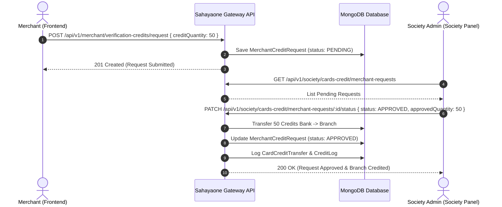
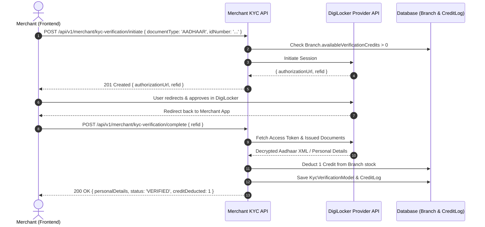

# Merchant Panel: Implementation, Architecture & Frontend Integration Guide

This guide details the system architecture, credit deduction lifecycle, end-to-end user workflows, frontend integration steps, sequence diagrams, and UI state management for the **Merchant Panel** of the Sahayaone Platform.

---

## Table of Contents

1. [Executive Summary & System Architecture](#1-executive-summary--system-architecture)
2. [Credit Lifecycle & Deduction Rules](#2-credit-lifecycle--deduction-rules)
3. [End-to-End Sequence Diagrams](#3-end-to-end-sequence-diagrams)
4. [Frontend Integration Guide (Step-by-Step UI Workflows)](#4-frontend-integration-guide-step-by-step-ui-workflows)
   - [4.1 Verification Credit Management & Request Screen](#41-verification-credit-management--request-screen)
   - [4.2 DigiLocker KYC Verification Workflow](#42-digilocker-kyc-verification-workflow)
   - [4.3 Experian CIBIL Score Check Workflow](#43-experian-cibil-score-check-workflow)
5. [Frontend Error Handling & UI States](#5-frontend-error-handling--ui-states)

---

## 1. Executive Summary & System Architecture

The Merchant Panel enables Merchants and Vendors to perform background customer verifications—including **DigiLocker KYC (Aadhaar & PAN)** and **Experian CIBIL Credit Score Checks**—to evaluate creditworthiness before issuing loans or EMI products.

### Core Architecture Components

- **Authentication**: JWT Access Token sent in headers (`Authorization: Bearer <TOKEN>`).
- **Role Restrictions**: Restricted strictly to `MERCHANT` and `VENDOR` roles.
- **Tenant Context**: Automatically resolves `merchantId`, `bankId` (associated Bank/Society), and `branchId` (assigned Branch) from `req.user` / `MerchantProfile`.
- **Credit Vault**: Verification credits are held and deducted at the **Branch level** (`Branch.availableVerificationCredits` & `Branch.verificationCredits`).

---

## 2. Credit Lifecycle & Deduction Rules

Verification credits follow a controlled lifecycle between Merchants, Society/Banks, and Branches:

```
[Merchant Panel] ---> Request Credits ---> [Society/Bank Panel] ---> Approve Request
                                                                          |
                                                                          v
[Branch Credit Balance] <--- Deduct 1 Credit <--- Execute KYC / CIBIL <--- Add Stock
```

### Key Business Rules

1. **Credit Request**: A Merchant requests verification credits from their associated Bank/Society (`POST /api/v1/merchant/verification-credits/request`).
2. **Society Approval**: Society Admin reviews the request (`GET /api/v1/society/cards-credit/merchant-requests`) and approves it (`PATCH /api/v1/society/cards-credit/merchant-requests/:id/status`). Upon approval, `approvedQuantity` credits are transferred from Bank wallet balance to the Merchant's assigned `Branch` balance.
3. **Pre-Check Validation**: When initiating or completing KYC verification or CIBIL score queries, the API verifies `branch.availableVerificationCredits > 0`. If `0`, a `400 Bad Request` is returned prompting the merchant to request credits.
4. **Automatic Deduction**: Each successful DigiLocker KYC completion or fresh CIBIL score query automatically deducts **1 credit** from `branch.availableVerificationCredits` and `branch.verificationCredits`.
5. **30-Day CIBIL Cache Rule**: If a CIBIL score check for the same PAN was performed within 30 days, the cached report is returned **without deducting credits**.
6. **Audit Trail**: Every deduction generates records in `CreditLog` and `CardCreditUsage` for complete financial transparency.

---

## 3. End-to-End Sequence Diagrams

### 3.1 Verification Credit Request & Approval Flow



### 3.2 DigiLocker KYC Verification & Credit Deduction Flow



---

## 4. Frontend Integration Guide (Step-by-Step UI Workflows)

### 4.1 Verification Credit Management & Request Screen

#### Recommended UI Layout
- **Balance Header**: Prominently display available credits (e.g., `Branch Available Verification Credits: 45`).
- **"Request Credits" Button**: Opens a modal with an integer input field for `creditQuantity` and optional `notes`.
- **Request History Table**:
  - Columns: Date, Quantity Requested, Status Badge (`PENDING` = Yellow, `APPROVED` = Green, `REJECTED` = Red), Response Remarks.

#### Integration Logic (React Example)

```typescript
import axios from 'axios';

// Submit Credit Request
const handleRequestCredits = async (creditQuantity: number, notes: string) => {
  try {
    const response = await axios.post(
      '/api/v1/merchant/verification-credits/request',
      { creditQuantity, notes },
      { headers: { Authorization: `Bearer ${userToken}` } }
    );
    toast.success('Credit request submitted successfully!');
    fetchRequestHistory();
  } catch (error: any) {
    toast.error(error.response?.data?.message || 'Failed to submit credit request.');
  }
};
```

---

### 4.2 DigiLocker KYC Verification Workflow

#### Screen Workflow
1. **Initiate Step**: User selects Document Type (`AADHAAR` / `PAN`) and enters the 12-digit Aadhaar / 10-digit PAN number.
2. **Redirect Step**: Open `authorizationUrl` in a new browser tab or popup modal.
3. **Callback Step**: Upon redirect back to your web app, extract `refid` from URL parameters and call `/complete`.
4. **Result Step**: Render verified name, gender, DOB, address, and render a "Download PDF Report" button.

#### Complete Verification Integration Snippet

```typescript
const completeKyc = async (refid: string) => {
  try {
    setLoading(true);
    const res = await axios.post(
      '/api/v1/merchant/kyc-verification/complete',
      { refid },
      { headers: { Authorization: `Bearer ${userToken}` } }
    );
    
    if (res.data.data.status === 'VERIFIED') {
      setKycResult(res.data.data);
      toast.success('KYC Verification Successful! 1 Credit Deducted.');
    }
  } catch (err: any) {
    if (err.response?.status === 400 && err.response?.data?.message.includes('credits')) {
      showInsufficientCreditsModal();
    } else {
      toast.error(err.response?.data?.message || 'KYC Completion Failed');
    }
  } finally {
    setLoading(false);
  }
};
```

#### Download KYC PDF Report

```typescript
const downloadKycPdf = async (refid: string, docType: 'AADHAAR' | 'PAN') => {
  const response = await axios.get(
    `/api/v1/merchant/kyc-verification/report/${refid}/download-pdf/${docType}`,
    {
      headers: { Authorization: `Bearer ${userToken}` },
      responseType: 'blob'
    }
  );
  
  const blob = new Blob([response.data], { type: 'application/pdf' });
  const url = window.URL.createObjectURL(blob);
  const link = document.createElement('a');
  link.href = url;
  link.setAttribute('download', `KYC_Report_${refid}.pdf`);
  document.body.appendChild(link);
  link.click();
};
```

---

### 4.3 Experian CIBIL Score Check Workflow

#### Screen Workflow
1. **Search Form**: Full Name, DOB (`YYYY-MM-DD`), PAN (`ABCDE1234F`), Mobile Number.
2. **Score Display Card**:
   - **Score Meter**: Circular gauge displaying score (300 to 900).
   - **Cache Badge**: If `cached: true`, display "Cached Report (0 Credits Deducted)".
   - **Download PDF**: Direct download link to Experian PDF report.

#### CIBIL Integration Snippet

```typescript
const handleCibilCheck = async (formData: { fullName: string; dob: string; pan: string; mobileNumber: string }) => {
  try {
    const res = await axios.post(
      '/api/v1/merchant/cibil-score',
      formData,
      { headers: { Authorization: `Bearer ${userToken}` } }
    );
    
    const { reportJson, pdfUrl, cached, creditDeducted } = res.data.data;
    setCibilReport({
      score: reportJson.score || reportJson.data?.score,
      pdfUrl,
      cached,
      creditDeducted
    });
  } catch (err: any) {
    toast.error(err.response?.data?.message || 'CIBIL Score Check Failed');
  }
};
```

---

## 5. Frontend Error Handling & UI States

### UI Response Matrix

| HTTP Status | Error Message / Scenario | Recommended UI Action |
| :--- | :--- | :--- |
| `400 Bad Request` | "No verification credits available in assigned branch..." | Open "Request Verification Credits" modal with direct form input. |
| `400 Bad Request` | "Minimum purchase quantity..." / "Validation failed" | Highlight input fields with inline red error messages. |
| `401 Unauthorized` | "Merchant user identity missing" / Invalid token | Clear session storage and redirect to `/merchant/login`. |
| `403 Forbidden` | "No associated Bank/Society context found..." | Display alert banner: "Your account is not assigned to a branch yet." |
| `404 Not Found` | "KYC verification session not found" | Show empty state with a "Retry Verification" button. |
| `500 Server Error` | Provider network outage | Show toast notification: "Service temporarily unavailable. Please try again later." |
