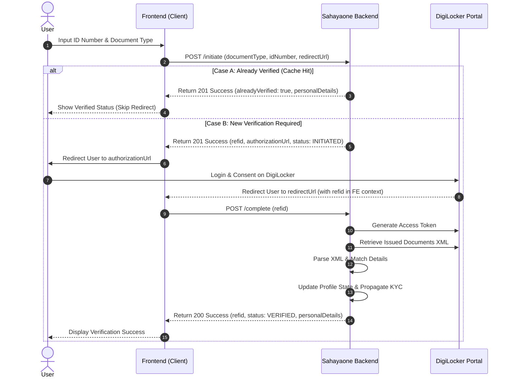

# DigiLocker KYC Verification API Reference

This document provides a detailed specification of the modular DigiLocker KYC Verification APIs in the Sahayaone ERP Backend. These endpoints are designed to orchestrate document-based verification (Aadhaar or PAN) via DigiLocker.

---

## 1. Overview & Base URL

All requests in this module are scoped to the **Society Panel** context.

* **Base Prefix:**
  ```http
  /api/v1/society/kyc-verification
  ```
* **Protocol & Domain:** e.g., `http://localhost:5000` (depending on environment)

---

## 2. Authentication & Global Headers

All routes in this module are secured and require session authentication.

### Required Headers

| Header Name | Value / Format | Description |
| :--- | :--- | :--- |
| `Authorization` | `Bearer <accessToken>` | **Required.** Bearer token generated during society authentication. |
| `Content-Type` | `application/json` | **Required** for all state-changing `POST` requests. |
| `Cookie` | `access_token=<token>` | Alternative cookie-based authentication fallback supported by the server. |

### Role-Based Access Control (RBAC) Permissions

All endpoints enforce fine-grained role capabilities derived from the user's assigned role in the Society Panel:

| Endpoint | Method | Path | Required Permission |
| :--- | :--- | :--- | :--- |
| Initiate Session | `POST` | `/initiate` | `kyc.create` |
| Complete Verification | `POST` | `/complete` | `kyc.create` |
| Get KYC History | `GET` | `/history` | `kyc.view` |
| Get Single Report | `GET` | `/report/:refid` | `kyc.view` |
| Download PDF Document | `GET` | `/report/:refid/download-pdf/:documentType` | `kyc.view` |

> [!IMPORTANT]
> The backend resolves the multi-tenant context (such as `societyId`, `branchId`, and the logged-in user profile) automatically from the authentication token. Frontend clients must **never** supply these contextual values in payloads or query parameters.

---

## 3. Integration Workflow

The DigiLocker KYC verification process follows an asynchronous authorization flow:



### Integration Steps:

1. **Step 1: Check/Initiate Session**
   Frontend captures the user's input (`documentType`, `idNumber`) and triggers `POST /initiate`, passing a valid client-side landing URL as `redirectUrl`.
   - **If cache hit (`alreadyVerified: true`):** The user's KYC is already complete. You can immediately skip the redirection.
   - **If new session (`status: INITIATED`):** Save the returned `refid` locally (e.g. `sessionStorage`) and redirect the user's browser window to the returned `authorizationUrl`.

2. **Step 2: User Authorization**
   The user authenticates on the DigiLocker page and approves consent. Once completed, DigiLocker redirects the user back to your specified `redirectUrl`.

3. **Step 3: Complete Verification**
   Upon landing back on the `redirectUrl`, retrieve the saved `refid` and call `POST /complete` to trigger the backend XML download, parsing, profile status propagation, and final status resolution.

---

## 4. Detailed Endpoints

---

### 4.1 Initiate KYC Session

* **Method:** `POST`
* **Path:** `/initiate`
* **Description:** Checks if a valid verification already exists for the given document and user. If not, requests an authentication session from DigiLocker and returns the target redirection URL.

#### Request Body (JSON)

```json
{
  "documentType": "AADHAAR",
  "idNumber": "123456789012",
  "consent": true,
  "redirectUrl": "https://frontend-app.com/kyc-callback"
}
```

#### Fields Description & Validation Constraints

* **`documentType`** (String, Required): Must be exactly `AADHAAR` or `PAN` (case-insensitive in request, normalized to uppercase by backend).
* **`idNumber`** (String, Required): The document identifier number. Must match the specified document pattern:
  * For `AADHAAR`: Exactly **12 digits** (e.g., `123456789012`).
  * For `PAN`: Exactly **10 alphanumeric characters** matching `^[A-Z]{5}[0-9]{4}[A-Z]{1}$` (e.g., `ABCDE1234F`).
* **`consent`** (Boolean, Optional): Explicit confirmation to fetch documents. Defaults to `true`.
* **`redirectUrl`** (String, Required): A valid web URI where the user will land after DigiLocker authentication.

---

#### Success Response Case A: New Session Created (201 Created)

Returned when no verified session exists and a new DigiLocker portal redirection is required.

```json
{
  "success": true,
  "statusCode": 201,
  "message": "DigiLocker KYC session initiated successfully.",
  "data": {
    "refid": "KYC_1723304561000_1234",
    "authorizationUrl": "https://api.sprintverify.in/digilocker/authorize?state=KYC_1723304561000_1234",
    "status": "INITIATED"
  }
}
```

#### Success Response Case B: Already Verified (201 Created)

Returned if a verification record matches the `societyId`, target `requestById`, and `idNumber` with a `VERIFIED` status in the DB.

```json
{
  "success": true,
  "statusCode": 201,
  "message": "DigiLocker KYC session initiated successfully.",
  "data": {
    "alreadyVerified": true,
    "refid": "KYC_1723300000000_9999",
    "status": "VERIFIED",
    "personalDetails": {
      "fullName": "MAMTA LODHI",
      "gender": "FEMALE",
      "dob": "15-08-1994",
      "fatherName": "RAMESH LODHI",
      "address": "S/O Ramesh Lodhi, Flat 402, Sunshine Apts, Pune, Maharashtra - 411001",
      "aadhaarVerified": true,
      "panVerified": false,
      "aadhaarStatus": "VERIFIED",
      "panStatus": "UNAVAILABLE",
      "availableDocuments": ["AADHAAR"],
      "unavailableDocuments": ["PAN"],
      "aadhaarNumber": "XXXXXXXX9012",
      "panNumber": null
    }
  }
}
```

---

#### Error Responses

* **422 Unprocessable Entity (Validation Error):**
  Returned if input attributes fail regex pattern checks or value parameters.
  ```json
  {
    "success": false,
    "statusCode": 422,
    "errorCode": "VALIDATION_ERROR",
    "message": "Invalid request payload format",
    "details": [
      {
        "field": "idNumber",
        "message": "Invalid Aadhaar number format. Must be 12 digits.",
        "location": "body.idNumber"
      }
    ]
  }
  ```

* **400 Bad Request:**
  Returned if external provider gateway APIs fail to initialize the authorization state.
  ```json
  {
    "success": false,
    "statusCode": 400,
    "errorCode": "UNEXPECTED_ERROR",
    "message": "Failed to initiate DigiLocker session",
    "details": null
  }
  ```

---

### 4.2 Complete KYC Verification

* **Method:** `POST`
* **Path:** `/complete`
* **Description:** Exchanges authorization parameters with DigiLocker, downloads identity XML documents, parses user identity details, strictly validates that the requested Aadhaar/PAN number matches the extracted DigiLocker document number, and updates profile state if matching succeeds.

#### Request Body (JSON)

```json
{
  "refid": "KYC_1723304561000_1234"
}
```

* **`refid`** (String, Required): The unique session reference ID returned by the `/initiate` API.

---

#### Success Response (200 OK)

```json
{
  "success": true,
  "statusCode": 200,
  "message": "DigiLocker KYC verification completed successfully.",
  "data": {
    "refid": "KYC_1723304561000_1234",
    "documentType": "AADHAAR",
    "idNumber": "123456789012",
    "status": "VERIFIED",
    "personalDetails": {
      "fullName": "MAMTA LODHI",
      "gender": "FEMALE",
      "dob": "15-08-1994",
      "fatherName": "RAMESH LODHI",
      "address": "S/O Ramesh Lodhi, Flat 402, Sunshine Apts, Pune, Maharashtra - 411001",
      "aadhaarVerified": true,
      "panVerified": false,
      "aadhaarStatus": "VERIFIED",
      "panStatus": "UNAVAILABLE",
      "availableDocuments": [
        "AADHAAR"
      ],
      "unavailableDocuments": [
        "PAN"
      ],
      "aadhaarNumber": "XXXXXXXX9012",
      "panNumber": null
    },
    "verifiedAt": "2026-08-10T14:15:32.481Z"
  }
}
```

> [!NOTE]
> When status resolves to `VERIFIED`, the backend automatically synchronizes corresponding values (Full Name, Date of Birth, Gender, Document Number) to the target profile (`CustomerProfile` or `SocietyEmployee`) and upgrades the KYC flags.

---

#### Error Responses

* **404 Not Found:**
  Returned if the `refid` does not exist or was created under a different tenant account.
  ```json
  {
    "success": false,
    "statusCode": 404,
    "errorCode": "RESOURCE_NOT_FOUND",
    "message": "KYC verification session not found",
    "details": null
  }
  ```

* **400 Bad Request (Document Number Mismatch):**
  Returned when the Aadhaar/PAN number entered during `/initiate` does not match the parsed ID number in the DigiLocker document. The session status is updated to `FAILED`, any parsed PII in `personalDetails` is set to `null` (and `rawXmlBase64` reset to `{ aadhaar: null, pan: null }`), and the error string is persisted in `lastError`.
  ```json
  {
    "success": false,
    "statusCode": 400,
    "errorCode": "BAD_REQUEST",
    "message": "Submitted AADHAAR number does not match the document retrieved from DigiLocker.",
    "details": null
  }
  ```

* **400 Bad Request (Requested Document Not Found):**
  Returned if the requested document type (`AADHAAR` or `PAN`) was not issued/found in the user's DigiLocker profile. The session status is updated to `FAILED`.
  ```json
  {
    "success": false,
    "statusCode": 400,
    "errorCode": "BAD_REQUEST",
    "message": "Requested document (AADHAAR) was not found in user's DigiLocker account.",
    "details": null
  }
  ```

* **400 Bad Request (DigiLocker Error):**
  Returned if DigiLocker operations fail or user account has no issued documents.
  ```json
  {
    "success": false,
    "statusCode": 400,
    "errorCode": "UNEXPECTED_ERROR",
    "message": "No documents found in this DigiLocker account",
    "details": null
  }
  ```

---

### 4.3 Get KYC Report

* **Method:** `GET`
* **Path:** `/report/:refid`
* **Description:** Retrieves the persistence record details of a specific KYC verification session using its reference ID.

#### Path Parameters

* **`refid`** (String, Required): The unique session reference ID.

---

#### Success Response (200 OK)

```json
{
  "success": true,
  "statusCode": 200,
  "message": "KYC verification report retrieved successfully.",
  "data": {
    "_id": "66b7a542b890f6c23000b4a1",
    "createdBy": "66b1a134a5d89ef2399bfcd2",
    "societyId": "66b1a03da5d89ef2399bfca1",
    "requestById": "66b79f8ab890f6c23000b48a",
    "refid": "KYC_1723304561000_1234",
    "documentType": "AADHAAR",
    "idNumber": "123456789012",
    "consent": true,
    "status": "VERIFIED",
    "authorizationUrl": "https://api.sprintverify.in/digilocker/authorize?state=KYC_1723304561000_1234",
    "redirectUrl": "https://frontend-app.com/kyc-callback",
    "personalDetails": {
      "fullName": "MAMTA LODHI",
      "gender": "FEMALE",
      "dob": "15-08-1994",
      "fatherName": "RAMESH LODHI",
      "address": "S/O Ramesh Lodhi, Flat 402, Sunshine Apts, Pune, Maharashtra - 411001",
      "aadhaarVerified": true,
      "panVerified": false,
      "aadhaarStatus": "VERIFIED",
      "panStatus": "UNAVAILABLE",
      "availableDocuments": ["AADHAAR"],
      "unavailableDocuments": ["PAN"],
      "aadhaarNumber": "XXXXXXXX9012",
      "panNumber": null
    },
    "billingCode": 200,
    "lastError": null,
    "verifiedAt": "2026-08-10T14:15:32.481Z",
    "createdAt": "2026-08-10T14:12:41.000Z",
    "updatedAt": "2026-08-10T14:15:33.000Z"
  }
}
```

---

### 4.4 Download KYC PDF Document

* **Method:** `GET`
* **Path:** `/report/:refid/download-pdf/:documentType`
* **Description:** Generates and downloads a formal verification report PDF containing verified details for the selected document.

#### Path Parameters

* **`refid`** (String, Required): The unique session reference ID.
* **`documentType`** (String, Required): Document verification node. Must be exactly `AADHAAR` or `PAN` (case-insensitive, normalized by server).

#### Response Type & Headers

* **`Content-Type`:** `application/pdf`
* **`Content-Disposition`:** `attachment; filename="kyc_verification_<refid>.pdf"`
* **Response Body:** Binary stream.

---

#### Error Responses

* **400 Bad Request (Report Pending/Failed):**
  Returned if the session is not in a `VERIFIED` state.
  ```json
  {
    "success": false,
    "statusCode": 400,
    "errorCode": "UNEXPECTED_ERROR",
    "message": "PDF report can only be generated for successfully verified sessions.",
    "details": null
  }
  ```

* **404 Not Found (Missing Document Verification Data):**
  Returned if the session was successfully verified for Aadhaar, but the client requests a PDF for PAN details (which were not verified in the session).
  ```json
  {
    "success": false,
    "statusCode": 404,
    "errorCode": "RESOURCE_NOT_FOUND",
    "message": "Verified details for PAN are not available in this session.",
    "details": null
  }
  ```

---

### 4.5 Get KYC Verification History

* **Method:** `GET`
* **Path:** `/history`
* **Permission:** `kyc.view`
* **Description:** Retrieves paginated history of all Aadhaar and PAN KYC verification sessions created within the active society context, with optional filters for document type, verification status, text search, and date range.

#### Query Parameters

| Parameter | Type | Required | Default | Description |
| :--- | :--- | :--- | :--- | :--- |
| `page` | Integer | No | `1` | Page number for pagination (minimum 1). |
| `limit` | Integer | No | `10` | Records per page (minimum 1, maximum 100). |
| `search` | String | No | - | Case-insensitive search on `refid`, `idNumber`, or parsed name/ID numbers. |
| `requestById` | 24-Hex String | No | - | Filter by target user ID for whom KYC was requested (`User` ObjectId). |
| `createdBy` | 24-Hex String | No | - | Filter by creator employee/user ID who initiated the KYC session (`User` ObjectId). |
| `documentType` | String | No | - | Filter by document type (`AADHAAR` or `PAN`). |
| `status` | String | No | - | Filter by session status (`INITIATED`, `VERIFIED`, `FAILED`, `EXPIRED`). |
| `startDate` | ISO Date | No | - | Start timestamp threshold (e.g. `2026-01-01T00:00:00.000Z`). |
| `endDate` | ISO Date | No | - | End timestamp threshold (e.g. `2026-12-31T23:59:59.999Z`). |

---

#### Success Response (200 OK)

```json
{
  "success": true,
  "statusCode": 200,
  "message": "KYC verification history retrieved successfully.",
  "data": {
    "stats": {
      "totalKyc": 25,
      "verified": 20,
      "failed": 5,
      "aadhaarVerified": 15,
      "panVerified": 5
    },
    "items": [
      {
        "_id": "66b7a542b890f6c23000b4a1",
        "createdBy": {
          "_id": "66b1a134a5d89ef2399bfcd2",
          "fullName": "John Doe",
          "email": "john@example.com"
        },
        "societyId": "66b1a03da5d89ef2399bfca1",
        "requestById": {
          "_id": "66b79f8ab890f6c23000b48a",
          "fullName": "Jane Smith",
          "email": "jane@example.com"
        },
        "refid": "KYC_1723304561000_1234",
        "documentType": "AADHAAR",
        "idNumber": "123456789012",
        "consent": true,
        "status": "VERIFIED",
        "authorizationUrl": "https://api.sprintverify.in/digilocker/authorize?state=KYC_1723304561000_1234",
        "redirectUrl": "https://frontend-app.com/kyc-callback",
        "personalDetails": {
          "fullName": "JANE SMITH",
          "gender": "FEMALE",
          "dob": "15-08-1994",
          "fatherName": "RAMESH SMITH",
          "address": "Flat 402, Sunshine Apts, Pune, MH",
          "aadhaarVerified": true,
          "panVerified": false,
          "aadhaarStatus": "VERIFIED",
          "panStatus": "UNAVAILABLE",
          "availableDocuments": [
            "AADHAAR"
          ],
          "unavailableDocuments": [
            "PAN"
          ],
          "aadhaarNumber": "XXXXXXXX9012",
          "panNumber": null
        },
        "billingCode": 200,
        "lastError": null,
        "verifiedAt": "2026-08-10T14:15:32.481Z",
        "createdAt": "2026-08-10T14:12:41.000Z",
        "updatedAt": "2026-08-10T14:15:33.000Z"
      }
    ],
    "pagination": {
      "total": 1,
      "page": 1,
      "limit": 10,
      "totalPages": 1
    }
  }
}
```

---

## 5. Reference: Schema Fields Guide

The properties returned under `personalDetails` map directly to the parsed data extracted from DigiLocker's signed XML files:

| Property Name | Data Type | Possible Values / Example | Description |
| :--- | :--- | :--- | :--- |
| `fullName` | String | `MAMTA LODHI` | Full name as written on the government ID card. |
| `gender` | String | `MALE` / `FEMALE` / `OTHER` | Gender parameter value. |
| `dob` | String | `15-08-1994` | Date of Birth in `DD-MM-YYYY` format. |
| `fatherName` | String | `RAMESH LODHI` | Name of the father, if extracted from the XML. |
| `address` | String | `"S/O Ramesh Lodhi, Flat..."` | Permanent address details (only parsed from Aadhaar XML). |
| `aadhaarVerified` | Boolean | `true` / `false` | Whether Aadhaar XML verification succeeded. |
| `panVerified` | Boolean | `true` / `false` | Whether PAN XML verification succeeded. |
| `aadhaarStatus` | String | `VERIFIED` / `UNAVAILABLE` / `FAILED` | Process lifecycle state of Aadhaar processing. |
| `panStatus` | String | `VERIFIED` / `UNAVAILABLE` / `FAILED` | Process lifecycle state of PAN processing. |
| `availableDocuments` | Array | `["AADHAAR"]` | Array of documents found inside the user's DigiLocker profile. |
| `unavailableDocuments` | Array | `["PAN"]` | Array of expected document types that were not discovered. |
| `aadhaarNumber` | String | `XXXXXXXX9012` | Masked Aadhaar number parsed from the verified document. |
| `panNumber` | String | `XXXXXX345F` | Masked PAN number parsed from the verified document. |
